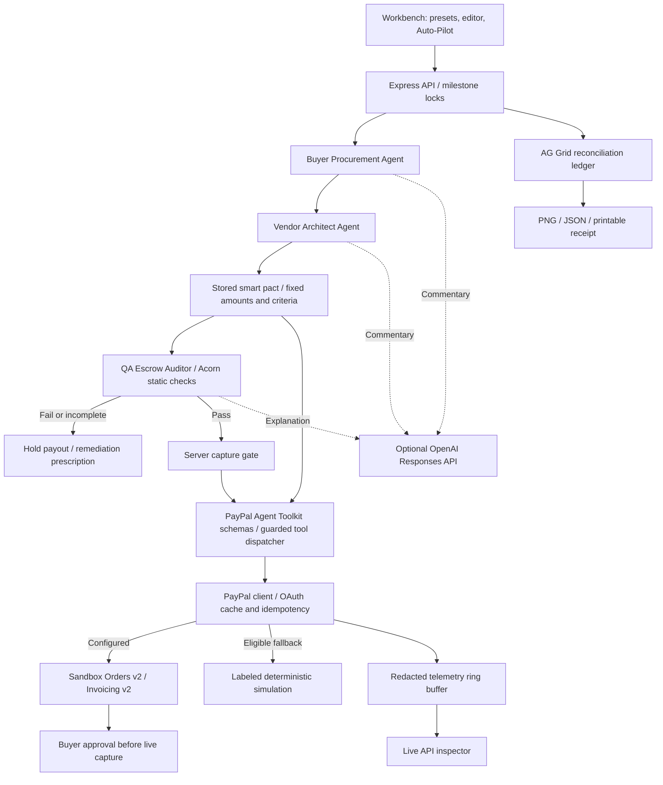

# DealPact AI

### Agree on the work. Verify the delivery. Release the payment.

DealPact AI is a B2B agentic commerce workbench for milestone-based software engagements. A Buyer Procurement Agent and Vendor Architect Agent agree on scope, budget, and delivery terms. A QA Escrow Auditor checks submitted evidence before the server permits PayPal Sandbox capture. An AG Grid ledger connects every milestone to its payment, audit decision, and API evidence.

**PayPal AI Hackathon 2026 · MIT licensed · English UI and documentation**

**Live demo:** [dealpact-ai.onrender.com](https://dealpact-ai.onrender.com) · **Health:** [/api/health](https://dealpact-ai.onrender.com/api/health)

## Problem statement

Small businesses and independent vendors manage a single engagement across proposals, chat, source code, invoices, and payment dashboards. Buyers need evidence that the work meets the agreement; vendors need a clear path to payment; finance needs to reconcile delivery with settlement.

DealPact AI puts that decision trail in one place: negotiate a pact, verify a deliverable, release or hold the payment, and export the evidence. The intended benefit is less manual coordination and clearer payment accountability. This prototype demonstrates that workflow; it does not claim measured savings or production adoption.

## 1-minute quickstart

Use **Node.js 22.9 or later** and npm. Node 24 is the verified runtime. Download or clone this repository and open a terminal in its root:

```sh
npm ci
npm run dev
```

Open **[http://localhost:3000](http://localhost:3000)**, select a scenario, and click **Judge Auto-Pilot**. No API keys are required for the labeled simulation. Installation needs npm access; afterward, the no-key demo serves fonts and AG Grid locally.

An `.env` file is optional. Preserve any existing file. To create a new one:

```powershell
# Windows PowerShell
if (-not (Test-Path .env)) { Copy-Item .env.example .env }
```

```sh
# macOS / Linux
test -f .env || cp .env.example .env
```

For predictable judging even on a machine with credentials, set `PAYPAL_SIMULATION=true` and leave `OPENAI_API_KEY` empty. Restart after changing environment values. Stop with Ctrl+C. Use `npm start` to run without file watching.

## Deploy to Render

[](https://render.com/deploy?repo=https://github.com/Helia-zhong/dealpact-ai)

The public source is [Helia-zhong/dealpact-ai](https://github.com/Helia-zhong/dealpact-ai). Click **Deploy to Render**, select your workspace, and enter your Sandbox app's `PAYPAL_CLIENT_ID` and `PAYPAL_CLIENT_SECRET` when prompted. Store these values in Render's environment settings; keep the local `.env` file out of Git.

The included `render.yaml` selects a free Node web service, runs `npm ci` and `npm start`, binds `0.0.0.0` using Render's assigned `PORT`, and checks `/api/health`. PayPal approval return/cancel links automatically use `RENDER_EXTERNAL_URL`; `APP_BASE_URL` remains an optional explicit override. No frontend build command is required.

After Render reports **Live**, open the service's actual public URL and verify `/api/health` returns `status: "ok"`. Run **Checkout migration** to verify provider connectivity and inspect its API telemetry. Use the URL shown by Render for the Devpost demo link; the service name alone does not guarantee a particular hostname. Free instances may sleep while idle. Pacts and telemetry are held in memory and reset when the service restarts.

## Judge testing instructions

### A 60-second demo

| Time | Action | Evidence |
| --- | --- | --- |
| 0–15s | Select **Checkout migration** and click **Judge Auto-Pilot**. | Agent conversation, three agreed milestones, order creation, passing QA, and completed simulated captures. |
| 15–25s | Open a PayPal Order ID or **API Inspector**. | Orders v2 request JSON, `201 Created`, request ID, debug ID, latency, and HATEOAS links. |
| 25–40s | Select **Security audit** and run Auto-Pilot. | All payouts held, 41/100 benchmark scores, SQL injection/ReDoS findings, hold alert, and remediation diff. |
| 40–50s | Select **Passing Deliverable** on a blocked milestone; run QA. | The replacement example is audited; a passing result permits simulated capture. |
| 50–60s | Open **Export PayPal Escrow Audit Certificate** or a row **Receipt**. | Payment IDs, check results, timestamps, hashes, and PNG/JSON/print controls. |

Timing assumes local simulation and deterministic agents. Live Sandbox and model responses depend on network latency and buyer approval.

### Four built-in scenarios

Run each preset once on a fresh server. These outcomes describe unedited fixtures in simulation.

| Scenario | Budget / milestones | Preset QA scores | Released / held | Demonstration |
| --- | --- | --- | --- | --- |
| SaaS Stripe-to-PayPal Checkout Migration | $4,500 / 3 | 94, 94, 94 | $4,500 / $0 | Order creation, capture gating, reconciliation. |
| Cross-Border E-Commerce AI Localization Microservice | $3,200 / 2 | 89, 89 | $3,200 / $0 | Localization checks, two draft invoices, captures. |
| Smart Contract Security Audit & Penetration Report | $6,000 / 3 | 41, 41, 41 | $0 / $6,000 | Vulnerable off-chain account code blocks capture. |
| Mobile App UI Kit & Design System | $2,400 / 2 | 92, 55 | $1,440 / $960 | Completed components release; incomplete screens remain held. |

Combined totals: **$9,140 released**, **$6,960 held**, **4 active milestones**, **60% audit pass rate**. Each Auto-Pilot run creates another pact and adds ledger rows.

### Custom input and capture protection

1. Edit scope, budget, or timeline; click **Negotiate pact**. Custom pacts contain three milestones split 40% / 35% / remainder, calculated in cents.
2. Select a milestone. Paste code/text, upload a text file under 100 KB, or choose **Passing Deliverable** / **Vulnerable/Incomplete Deliverable**. Extra custom criteria supplied through the API may require adapting the example.
3. Disable automatic capture to inspect QA separately. Create an order, select the failing example, and run QA. Capture stays disabled. Direct capture requests return HTTP 409 without contacting the provider capture endpoint.
4. Select the passing example and re-audit. Capture becomes available. Editing accepted evidence requires re-audit in the UI; submitting a failed audit revokes the stored pass on the server.
5. Switch milestones to inspect separate drafts. Drafts remain while the page is open. Released milestones and pending captures are locked against further audits.

Plain text, unsupported languages, and incomplete diffs remain held when the JavaScript auditor cannot verify them. Prose alone does not authorize payment.

### Ledger, telemetry, and certificates

**AG Grid:** search all fields, filter by status, sort desktop columns, and inspect the pinned total for visible rows. Inline Order/Audit/Capture/Receipt actions operate on actual milestones. CSV/JSON exports follow the active filter. Narrow screens use milestone cards inside AG Grid.

**Telemetry:** inspect request headers/body, response status/body, debug ID, latency, and links. Credentials are redacted. Select PayPal, agent, application, or local workbench activity. Live approval URLs open Sandbox; simulated URLs are labeled examples.

**Certificates:** export PNG or complete JSON, copy JSON, or print a white receipt. Held records say “Not captured”; completed records contain Capture IDs. Check breakdowns distinguish preset benchmark scores from custom static-check scores.

The artifact SHA-256 covers trimmed submitted text. The receipt SHA-256 covers UTF-8 `JSON.stringify(payload)` before `integrity` is added. Verify by removing `integrity`, preserving the remaining property order, serializing, and comparing the digest to `integrity.value`. The companion PNG displays the same checksum. These are unsigned app-issued records, not PayPal-issued certificates.

## Architecture



| Agent | Responsibility | Authority boundary |
| --- | --- | --- |
| Buyer Procurement Agent | Budget ceiling, milestone splits, acceptance terms, SLA penalties. | Cannot change agreed amounts during checkout. |
| Vendor Architect Agent | Engineering scope, estimated hours, planning rate, timeline. | Structured pact data is validated server-side. |
| QA Escrow Auditor Agent | Acceptance checks, test/assertion evidence, security findings, release/hold explanation. | Capture needs the latest stored pass and live buyer approval. |

The deterministic orchestrator computes structured pacts, invokes structured PayPal tools, and controls audit decisions. Negotiation creates the first milestone order; QA release invokes invoice/order/capture tools as needed. Optional model output enriches messages and explanations. Model prose cannot override capture authorization or execute submitted code.

```text
server/
  index.js          Routes, pact storage, capture gate, static assets
  paypalClient.js   OAuth, Orders/Invoices v2, idempotency, simulation, telemetry
  paypalAgentTools.js Official toolkit validation, function/MCP schemas, guarded dispatch
  agentEngine.js    Three agent roles, four presets, custom pacts, static QA
  telemetryStore.js Bounded and redacted request/response history
public/
  index.html        Workbench and dialogs
  styles.css        Dark terminal, responsive layouts, print receipt
  app.js            UI orchestration, AG Grid, inspector, receipt export
test/
  smoke.test.js     Process startup, HTTP workflows, provider transport tests
.env.example        Optional configuration; empty secret fields
LICENSE             MIT
```

## Tools & AI Statement

This statement describes work actually performed. Referenced tools are not automatically runtime dependencies.

### PayPal Sandbox Orders v2 and Invoicing v2 — implemented

[server/paypalClient.js](server/paypalClient.js) sends requests to `https://api-m.sandbox.paypal.com`:

| Endpoint | Use |
| --- | --- |
| `POST /v1/oauth2/token` | Client-credentials OAuth, token cache, refresh/retry after an API 401. |
| `POST /v2/checkout/orders` | Fixed-amount milestone orders, `PayPal-Request-Id`, approval links. |
| `GET /v2/checkout/orders/:id` | Lookup, buyer-approval checks, provider-state reconciliation. |
| `POST /v2/checkout/orders/:id/capture` | Idempotent capture after stored QA acceptance and live buyer approval. |
| `POST /v2/invoicing/invoices` | Draft milestone invoices for localization; follows minimal invoice self-link responses when needed. |

PayPal is central to settlement. Draft invoices are never sent. Tests validate payloads, token reuse, request IDs, errors, debug IDs, and pending/incorrect capture handling. Live credentials and buyer approval remain necessary for a real Sandbox end-to-end check.

### `@paypal/agent-toolkit` — integrated with guarded execution

The pinned **`@paypal/agent-toolkit@1.11.0`** dependency is imported by [server/paypalAgentTools.js](server/paypalAgentTools.js). It instantiates the official `PayPalAgentToolkit` AI SDK adapter in Sandbox mode with only order create/get/capture and invoice create actions enabled. Every accepted call validates the payment parameters against the official toolkit's runtime schemas before execution.

| DealPact function | Official toolkit action | Behavior |
| --- | --- | --- |
| `paypal_create_order` | `create_order` | Creates/reuses the order for an agreed milestone. |
| `paypal_get_order` | `get_order` | Reads an order after checking milestone ownership. |
| `paypal_capture_order` | `pay_order` | Applies the latest stored QA pass, buyer approval, amount reconciliation, and idempotency gates. |
| `paypal_create_draft_invoice` | `create_invoice` | Creates/reuses a draft invoice; never sends it. |

The module exports strict function-calling JSON schemas and matching MCP tool definitions. `GET /api/paypal/tools` exposes both catalogs, and `handleToolCall` accepts a structured function call and returns its correlated tool result. These are application aliases with pact/milestone identifiers; amounts and idempotency keys come from server state. Unknown tools, extra arguments, foreign orders, and failed QA are rejected.

**Execution boundary:** the official package supplies tool discovery and parameter validation. DealPact's dispatcher executes through the existing instrumented REST client rather than the toolkit's built-in network executors, preserving complete request/response telemetry and deterministic fallback. This is a toolkit schema adapter with application-owned execution, not a hosted MCP server. The optional OpenAI request supplies narrative only; the deterministic agent orchestrator invokes the payment tools. No credentials are passed to the schema adapter.

Negotiation registers the pact and invokes `paypal_create_order` for Milestone 1. If the provider rejects creation, the agreed pact remains available with a retryable `paymentPreparation` error. QA release invokes the invoice tool when required, reuses/creates the order, and invokes the capture tool. All tools share milestone locks with HTTP routes and log `AGENT` telemetry alongside the PayPal HTTP trace. Repeated checkout clicks reuse the same order.

### OpenAI Codex and optional OpenAI API — used

**Development:** OpenAI Codex assisted with implementation, fixtures, static QA heuristics, tests, browser verification, remediation UI, receipt rendering, and documentation. The repository contains AI-assisted code and text.

**Runtime:** [server/agentEngine.js](server/agentEngine.js) optionally uses the OpenAI Responses API with JSON-schema structured output and `store: false`. The default model is `gpt-4o-mini`, overrideable through `OPENAI_MODEL`. Missing credentials, failed requests, or unusable output fall back to deterministic messages. Automated tests mock model responses and consume no API credits.

When enabled, scope/pact information and up to 16,000 artifact characters, criteria, and inspection results are sent for commentary. The no-key path sends none of that data to OpenAI. Commentary does not replace static audit decisions.

### AG Grid Community — integrated into the product

The installed `ag-grid-community` package is served locally. [public/app.js](public/app.js) calls `agGrid.createGrid` with a dark Quartz theme, status badges, QA score bars, clickable payment/debug IDs, inline actions, global search, external status filters, sorting, pinned totals, CSV export, and responsive card cells.

Row actions call application APIs; filters update totals and exports; receipts expose stored evidence. This is **AG Grid Community**, not Enterprise or AG Studio. No enterprise license key is required.

### APIMatic PayPal Context Plugin — used during final verification

Codex loaded published TypeScript skills from the [PayPal Server SDK Context Plugin preview](https://github.com/paypaldev/server-sdk-context-plugin-preview), pinned to [revision `6aa057126f0d4709a42e15002aab832a94935d92`](https://github.com/paypaldev/server-sdk-context-plugin-preview/tree/6aa057126f0d4709a42e15002aab832a94935d92). The source was read directly from a local checkout. This was development-time context use, not a globally installed IDE plugin or runtime SDK integration.

The guidance informed concrete additions to [test/smoke.test.js](test/smoke.test.js):

| Context source | Applied verification |
| --- | --- |
| [TypeScript testing](https://github.com/paypaldev/server-sdk-context-plugin-preview/blob/6aa057126f0d4709a42e15002aab832a94935d92/skills/typescript/typescript-testing/SKILL.md) | Capture every intercepted request, distinguish OAuth from operations, assert wire method/body and concrete errors through the existing injected `fetchImpl`. |
| [Error handling](https://github.com/paypaldev/server-sdk-context-plugin-preview/blob/6aa057126f0d4709a42e15002aab832a94935d92/skills/typescript/typescript-error-handling/SKILL.md) | Preserve provider HTTP status, JSON details, and debug ID through the application boundary without simulating success. |
| [Configuration and resilience](https://github.com/paypaldev/server-sdk-context-plugin-preview/blob/6aa057126f0d4709a42e15002aab832a94935d92/skills/typescript/typescript-configuration-resilience/SKILL.md) | Test effective deadlines on both OAuth and order requests; log the failed attempt before permitted fallback. |

The source describes an APIMatic-generated SDK. Its SDK-specific adapters and types were not copied into the direct REST transport. `@paypal/paypal-server-sdk` is now a transitive Agent Toolkit dependency; DealPact does not invoke its payment transport. The contribution claimed here is context-assisted integration verification. See [APIMatic's plugin overview](https://context.apimatic.io/plugins/paypal/).

### Other tools

Node.js ES modules and Express serve the app. Acorn parses JavaScript without executing it. Node's test runner and strict assertions exercise HTTP/payment paths. Web Crypto and Canvas generate checksums and PNGs; Fontsource hosts local fonts.

### Prize-category evidence

| Category | Demonstrated evidence | Qualification statement |
| --- | --- | --- |
| Grand Prize | PayPal-centered working application, AI-assisted development, optional runtime model, runnable source, MIT license, tests. | For consideration subject to all entry rules. |
| Best Use of Agentic Commerce | Negotiation → structured PayPal tools → acceptance evidence → controlled capture → reconciliation, including denial and remediation. | Official toolkit schema validation with application-controlled REST execution. |
| Best Use of AG Grid | Working reconciliation terminal with renderers, actions, filtering, totals, exports. | Actual AG Grid Community integration. |
| Best Use of APIMatic | Pinned Context Plugin sources and resulting error/transport/timeout tests. | Development-time context use disclosed; organizer acceptance is not guaranteed. |

The [official rules](https://paypalaihackathon.devpost.com/rules) determine eligibility and awards. This is an evidence map, not a certification of qualification. A public repository and functional demo access must still accompany the entry.

## Configuration and live Sandbox testing

| Variable | Purpose |
| --- | --- |
| `PAYPAL_CLIENT_ID`, `PAYPAL_CLIENT_SECRET` | Sandbox REST app credentials, stored in local `.env` or deployment environment settings. |
| `PAYPAL_ENV` | `sandbox` only; production is rejected. |
| `PAYPAL_SIMULATION` | `true` forces simulation even with credentials present. |
| `OPENAI_API_KEY` | Optional model commentary; empty selects deterministic agents. |
| `OPENAI_MODEL` | Optional Responses API model override. |
| `PORT`, `HOST` | Defaults: `3000`, `127.0.0.1`. |
| `APP_BASE_URL` | Optional browser origin override for approval return/cancel links. |
| `RENDER_EXTERNAL_URL` | Render-provided public origin, used automatically when `APP_BASE_URL` is unset. |

For live testing, configure Sandbox app credentials, set `PAYPAL_SIMULATION=false`, and restart. Negotiate, create an order, and run a passing audit. Follow **Approve in Sandbox** and sign in with a Sandbox personal buyer account. Return to the workbench and click **Capture payout**. Only completed USD captures matching the milestone amount become `RELEASED`. The default Judge Auto-Pilot path makes a capture attempt, verifies a still-unapproved live order with `GET /v2/checkout/orders/:id`, and can issue a clearly labeled `RELEASED_SIMULATED` Instant Sandbox Settlement Bridge receipt for the first passing milestone. The bridge is application evidence only; it does not claim that PayPal captured funds. Uncheck the bridge option to require manual buyer approval.

Health reports `NOT_VERIFIED` until a successful provider request. Configuration alone does not prove a completed payment. Inspect the connection badge and each telemetry record.

## API reference

POST requests require JSON. Amounts come from the stored pact. Errors return `{error:{code,message,debugId,details}}`.

| Method | Route | Input / result |
| --- | --- | --- |
| GET | `/api/health` | Service, payment mode, agent mode, storage status. |
| GET | `/api/scenarios` | Four scenarios, criteria, default artifacts, and variants. |
| POST | `/api/negotiate` | `{scenarioId}` or `{scope,budget,timelineDays?,client?,vendor?,acceptanceCriteria?}`; returns pact/messages and first-order `paymentPreparation`. |
| GET | `/api/paypal/tools` | Four strict function schemas and equivalent MCP tool definitions. |
| GET | `/api/pacts/:id` | Stored pact and milestone state. |
| GET | `/api/milestones` | Ledger rows, financial totals, pass rate. |
| POST | `/api/paypal/orders` | `{pactId,milestoneId}`; creates or returns the existing order. |
| GET | `/api/paypal/orders/:id` | Provider-shaped order details and mode. |
| POST | `/api/paypal/orders/:id/capture` | `{instantSettlement?:boolean}`; 409 for failed QA, 202 while approval/capture is pending, or 200 with a labeled `RELEASED_SIMULATED` bridge receipt after live order verification. |
| POST | `/api/paypal/invoices` | `{pactId,milestoneId,recipientEmail?}`; draft only. |
| POST | `/api/qa-audit` | `{pactId,milestoneId,usePreset:true}` or `{pactId,milestoneId,deliverable:"..."}`; optional `autoCapture:false`. |
| POST | `/api/scenarios/:id/run` | Negotiation and preset audits; optional `autoCapture:false`. |
| GET | `/api/telemetry` | Optional `after`, `limit` (1–500), and `source` (`PAYPAL`, `AGENT`, `APPLICATION`). |
| GET | `/api/paypal/return?token=...` | Approval return details; never captures on GET. |
| GET | `/api/paypal/cancel` | Cancellation message; no capture. |

Provider results use `{data,mode,simulated,httpStatus,debugId,telemetryId}`; raw provider JSON is in `data`. Negotiation prepares the first milestone order through the agent tool. Backend preset runs create further resources only as needed for passing audits. Browser Auto-Pilot prepares every order before auditing, so blocked orders remain visible. Creating an order never captures funds.

## Verification

```sh
npm run check
npm test
```

**Verified: 26 tests passing on Node.js 24.16.0.** The suite starts HTTP listeners on ephemeral loopback ports and launches the actual server entrypoint in a child process. It closes its servers afterward, needs no existing dev server, reads no project `.env`, and makes no external API calls.

| Coverage | Assertions |
| --- | --- |
| Startup/assets | Missing optional env file, health, scenarios, HTML/CSS/JS, AG Grid, local fonts. |
| Four presets | Exact scores, release/block/partial outcomes, invoices, aggregate totals. |
| Custom pacts | Validation, cent totals, submitted artifacts, milestone ownership. |
| Capture gate | No outbound capture after failed QA; failed resubmission revokes pass; forged fields/amounts rejected; finalized audit locked. |
| Idempotency | Duplicate/concurrent requests produce one payment operation and stable results. |
| PayPal transport | Token cache/refresh, payloads, request IDs, errors, deadlines, fallback limits, buyer approval, pending/incorrect captures. |
| Telemetry | Correlated request/response, status/debug/latency/links, cursors, bounded storage, nested redaction. |
| AI/artifacts | Model success/failure, deterministic fallback, static analysis, SQL/regex findings, missing-evidence remediation. |
| Agent Toolkit | Four catalogs and structured results, negotiation and QA tool invocation, malformed/forged inputs, ownership/QA rejection, and retryable provider failures. |

Separate browser verification covered all four Auto-Pilots, custom editing, failed-to-passing resubmission, stale-draft capture protection, ledger controls, PNG/JSON exports and checksums, and layouts from 320 to 1440 pixels. Native printer output was not verified. Provider and model tests use mocks; no live PayPal account or model API is exercised by `npm test`.

**Live Sandbox connectivity verified separately on 2026-10-25 at 06:42:49 UTC**, using the owner's local credentials:

| Request | Actual provider result | PayPal debug ID |
| --- | --- | --- |
| `POST /v1/oauth2/token` | HTTP 200; token retained only in memory | `ca4ff3e3cad9e` |
| `POST /v2/checkout/orders` | HTTP 201 Created; USD 1.00 order `6TM797598B043574B` | `ca4ff3e3ff914` |

The check asserted live mode, HTTP 201, a provider order ID, and a non-simulated debug ID. It did not request capture. Sanitized evidence is saved in [test/live-sandbox-verification.json](test/live-sandbox-verification.json); no credentials or access tokens are included. This verifies authentication and order creation, not buyer approval, invoice creation, or settlement against the live Sandbox account.

The running workbench was also checked through its UI: negotiation invoked `paypal_create_order` with the real Checkout Migration amounts (M1 `$1,800`, M2 `$1,575`, M3 `$1,125`). Auto-Pilot created three live Sandbox orders, attempted capture for M1, verified its still-unapproved order, and displayed a `$1,800.00` `RELEASED_SIMULATED` bridge receipt while keeping the PayPal approval link. The UI displayed **LIVE PAYPAL SANDBOX**, the ledger displayed the Agent Tool and PayPal Debug ID columns, the desktop workspace used two equal columns, and the ledger used AG Grid auto-height without a blank gap.

## Operating limits

- **Sandbox only:** no production funds move. “Held” is an application state; a `CAPTURE` order does not reserve funds or create a regulated escrow account.
- **Static QA:** submitted code and test evidence are inspected, never executed. Scores do not certify full functionality/security. Scenario 3 inspects off-chain JavaScript, not deployed smart-contract bytecode.
- **Benchmark scores:** unedited presets use reproducible fixture labels. Pasted/toggled examples use actual checks and the security cap.
- **Fallback:** missing/invalid credentials, network errors, and eligible 5xx responses can simulate new resources. Existing live-order lookup/capture never becomes simulated success. Business errors remain errors. Timed-out creation can have an unknown provider outcome.
- **State/access:** in-memory pacts, idempotency records, simulation, and telemetry reset on restart. There is no authentication, durable ledger, webhook listener, or production escrow service; the default bind address is loopback.
- **Secrets/evidence:** `.env` is ignored; telemetry redacts credentials. Business data may remain in local records. Receipt hashes detect changes, not issuer authenticity.
- **Toolkit dependencies:** the pinned toolkit currently brings upstream dependency advisories (`npm audit`: 11 high, 1 moderate on 2026-10-25). The app uses its schema adapter, with payment transport owned by DealPact. Dependency security review is still required before production use; passing workflow tests do not clear those advisories.

## Devpost handoff

This package contains runnable source, a dependency lockfile, MIT license, English documentation, judge scenarios, and automated verification. To submit:

1. Publish the source repository and provide its actual public URL. Exclude `.env`, credentials, and `node_modules`.
2. Supply these setup instructions or a working hosted demo. A localhost URL is not remotely accessible to judges.
3. Record a working demo showing settlement, blocked delivery, remediation, and AG Grid/telemetry evidence.
4. Copy the Tools & AI Statement accurately, including the Agent Toolkit schema/execution boundary and development-time APIMatic context use.
5. Complete actual team details, video/demo URLs, and required entry fields. Repository preparation does not publish or submit an entry.

## References and license

Implementation references: [PayPal authentication](https://developer.paypal.com/api/rest/authentication/), [Orders v2](https://developer.paypal.com/docs/api/orders/v2/), [Invoicing v2](https://developer.paypal.com/docs/api/invoicing/v2/), [PayPal Agent Toolkit](https://github.com/paypal/agent-toolkit), [AG Grid documentation](https://www.ag-grid.com/javascript-data-grid/getting-started/), and the APIMatic sources above.

MIT. See [LICENSE](LICENSE). Dependency licenses remain their respective authors' licenses.
